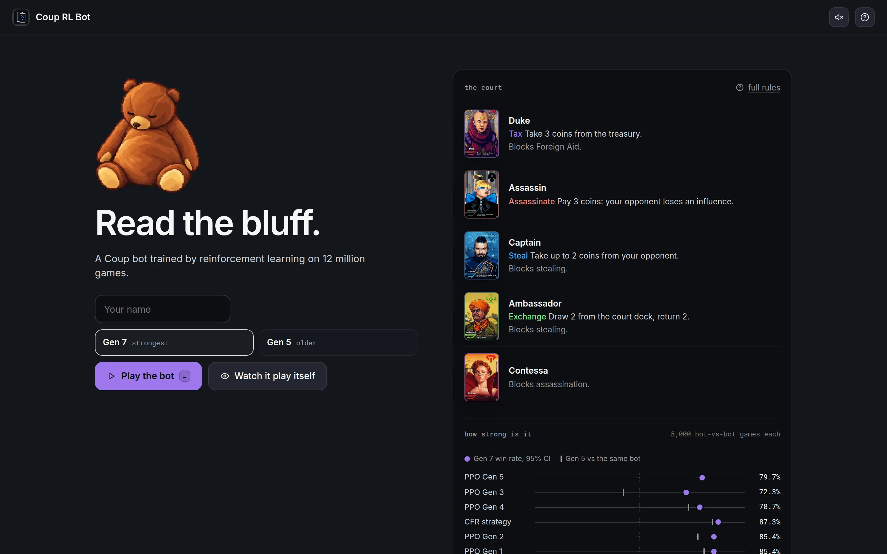
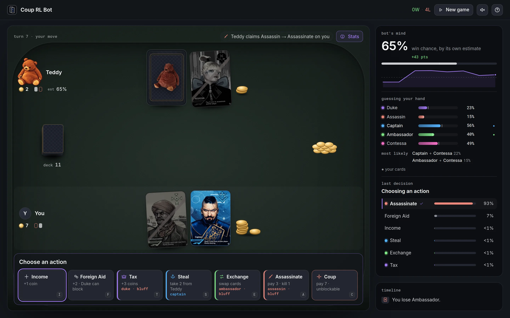
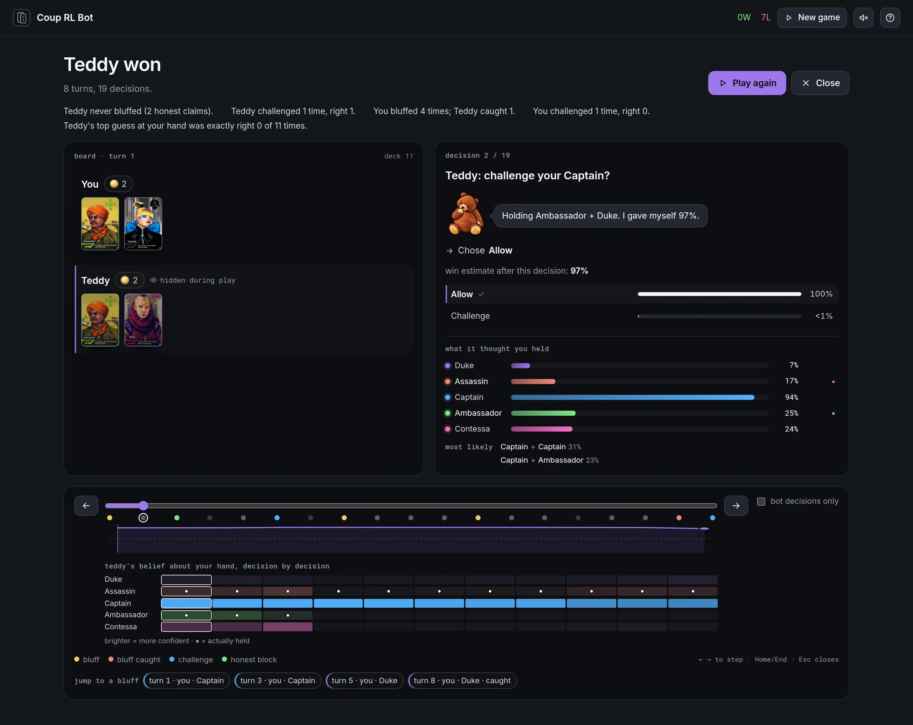
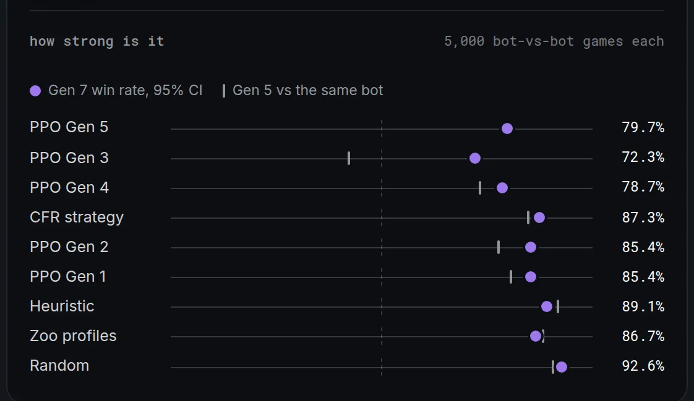
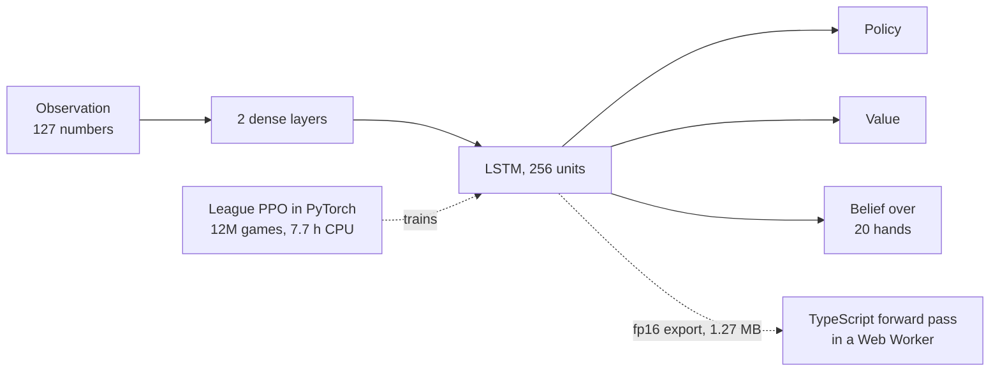

# Coup RL Bot

A reinforcement-learning bot for 1v1 [Coup](https://en.wikipedia.org/wiki/Coup_(card_game))
that bluffs, calls bluffs and guesses your hidden cards. It runs entirely in your browser.

**Play it → https://coup.austxu.dev**

[](https://coup.austxu.dev)

**Mid-game, with Teddy's stats open.** The panel shows the bot's own win estimate, its
guess at your two hidden cards, and the probabilities behind its last move. Stats are
hidden by default while you play; the **Stats** button shows them.



**Reviewing a game.** After each game you can step through every decision with both
hands face up. The heatmap at the bottom shows Teddy's guess at each role, decision by
decision; dots mark the cards you actually held.



## Results

Teddy is the seventh generation of the bot (Gen 7). It played 5,000 games against each
opponent, alternating seats, scored with 95% Wilson intervals:

| Opponent | Gen 7 win rate | 95% CI |
| --- | --- | --- |
| PPO Gen 5 (the previous bot) | **79.7%** | 78.6–80.8 |
| CFR (MCCFR, 5M iterations) | **87.3%** | 86.4–88.2 |
| Rule-based heuristic | **89.1%** | 88.2–90.0 |
| Random zoo profiles | **86.7%** | 85.7–87.6 |
| Uniform random | **92.6%** | 91.8–93.3 |

It beats every earlier generation. The largest gain is against Gen 3, which Gen 5 lost
to (42.3%) and Gen 7 beats 72.3% of the time. Gen 5 still does slightly better against
the heuristic (91.7%) and the zoo profiles (88.4%). All of these are bot-vs-bot games.



**Guessing your hand.** Over 499,482 decisions in those bot-vs-bot games, Teddy's top
guess was exactly the opponent's hand **46.4%** of the time. Card counting alone, weighting every hand still
possible by how many ways it can be dealt, gets **20.4%**. Teddy never sees your cards:
it guesses from claims, blocks, challenges and revealed cards, and the true hand is used
only as a training label.

## Architecture

At each decision the game, as seen from the bot's seat, becomes 127 numbers: its own
cards, both players' coins and face-up cards, how many copies of each role are unseen,
both players' claims and caught bluffs, and the last four actions. Two dense layers feed
a 256-unit LSTM that remembers the whole game. Three heads read from it: a policy over
the legal actions, a value (its win estimate), and a belief over the 20 hands the
opponent could hold, with impossible hands masked out by card counting.



**Training.** League PPO: 1,000 updates of 12,000 games each. Every update mixes 35%
self-play, 20% frozen snapshots of itself, and 45% a fixed pool (Gens 1–5, CFR, the
heuristic, the zoo profiles and random). Opponents are weighted by
(1 − win rate)² + 0.02, so it plays most against whatever it still loses to. A critic that
also sees the opponent's hand steadies training and is dropped before export. Games
run as greenlets, with every pending decision batched into one forward pass, so
12 million games took 7.7 hours on a CPU.

**In the browser.** The weights ship as float16, 1.27 MB. The game engine is a
line-for-line TypeScript port of the Python one, and the network runs in TypeScript in
a Web Worker, so there is no server. Replaying recorded Python games, the TypeScript
engine and encoder match exactly. The network matches the PyTorch float16 reference
to within a max |Δlogit| of 4.8e-6, and float16 picks the same top action as float32 in all 1,314 Gen 7
decisions.

## Generations

Gens 1–4 were small LSTM-64 agents trained against scripted opponents and themselves.
Gen 5, the previous bot, trained on 3.5M games, mostly self-play, and never faced Gen 3.
Gen 6 was a 2–6 player experiment. Gen 7 added the league, the belief head and a fuller
observation. The full table is in [docs/DEVELOPMENT.md](docs/DEVELOPMENT.md#generations).

## Repository map

- `coup/`: Python engine, encoders, PPO models, CFR and training scripts (`train_gen7.py`)
- `versions/`: checkpoints and training logs for each generation
- `tools/`: weight export, parity fixtures, evaluation, training curves, asset builders
- `web/src/engine/`: TypeScript port of the engine and encoders
- `web/src/bot/`: the Web Worker that loads the weights and runs the network
- `web/src/ui/`: the Preact interface
- `web/test/`: parity replays against recorded Python games
- `docs/`: development notes and screenshots

## Run it locally

```bash
git clone https://github.com/austxu/coup-RL-bot.git
cd coup-RL-bot/web
npm ci
npm run dev
```

Training, export, the parity tests, deployment, URL parameters, the full evaluation and
the data files the portfolio reads are documented in
[docs/DEVELOPMENT.md](docs/DEVELOPMENT.md).
